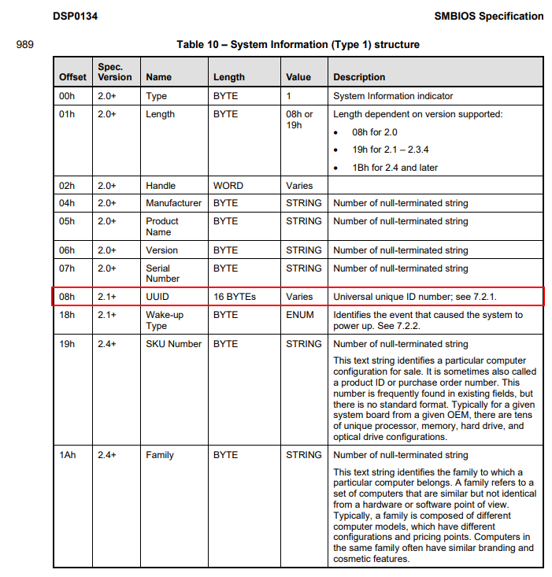

## Unique machine identifier

The WMI [`Win32_ComputerSystemProduct`](https://learn.microsoft.com/en-us/windows/win32/cimwin32prov/win32-computersystemproduct) class has a `UUID` field with a Universally unique identifier (UUID) for this product. It comes from the "System Information" structure in the SMBIOS

## SMBIOS specification extract
From [SMBIOS Specification 3.10.0](https://www.dmtf.org/sites/default/files/standards/documents/DSP0134_3.10.0.pdf):  
  

## Alternative approaches
* WMI: `wmic csproduct get uuid`
* PowerShell: `Get-WmiObject -Class "Win32_ComputerSystemProduct" | Select-Object -Property UUID`
* Win32: [`GetSystemFirmwareTable('RSMB')`](https://learn.microsoft.com/en-us/windows/win32/api/sysinfoapi/nf-sysinfoapi-getsystemfirmwaretable) - this project
